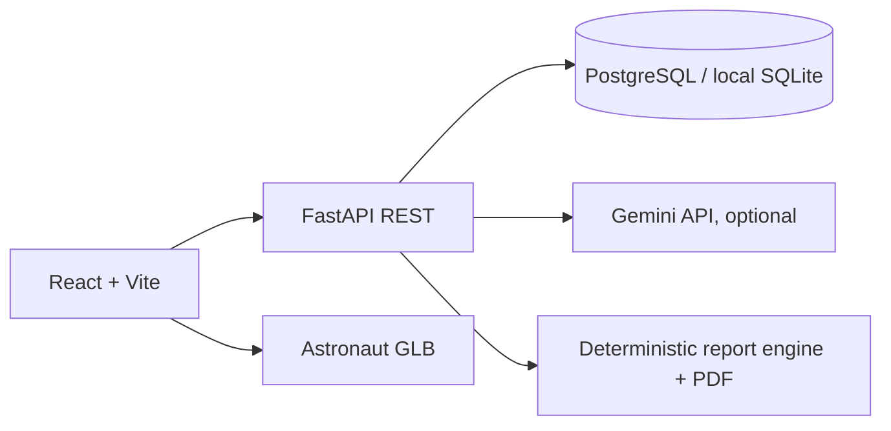

# Architecture

The frontend uses React Router for ten sections and TanStack Query for server state. The backend owns stored observations, check-ins, and report calculations. Gemini receives a bounded slice of recent records and cannot alter report values. Demo seed records are synthetic and their provenance is stored on every metric.

The service worker caches the app shell and fetched static assets. Successful API GET responses are stored in IndexedDB for offline fallback. Mental check-ins queue in IndexedDB without a connection and replay on reconnect with an idempotency key. Other mutations require the backend. HTTP errors during replay remain in the queue and are shown in the interface. The 3D scene lazy-loads the supplied GLB; it currently has one suit mode. Anatomy systems need separate licensed assets.

The current role header is explicitly a demo control and provides no real security. See README before any public deployment.
