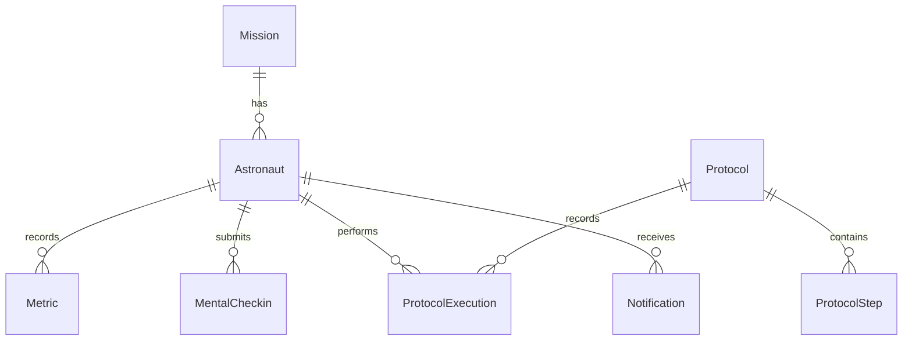

# Database

`backend/migrations/versions/` contains the initial Alembic schema. Set `DATABASE_URL` and run `alembic upgrade head` from `backend/`. PostgreSQL is the Compose default; SQLite is a local evaluation fallback.

Metric uniqueness is `(astronaut_id, key, sampled_at)`. Metrics store value, unit, source, and sample time. Check-ins store five bounded 1–5 scores and an optional comment. Report data is calculated on request and is not AI-generated. `MissionEvent` stores timeline entries.
