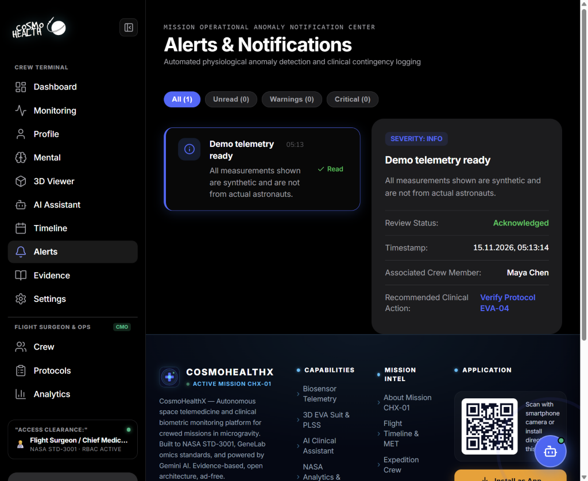
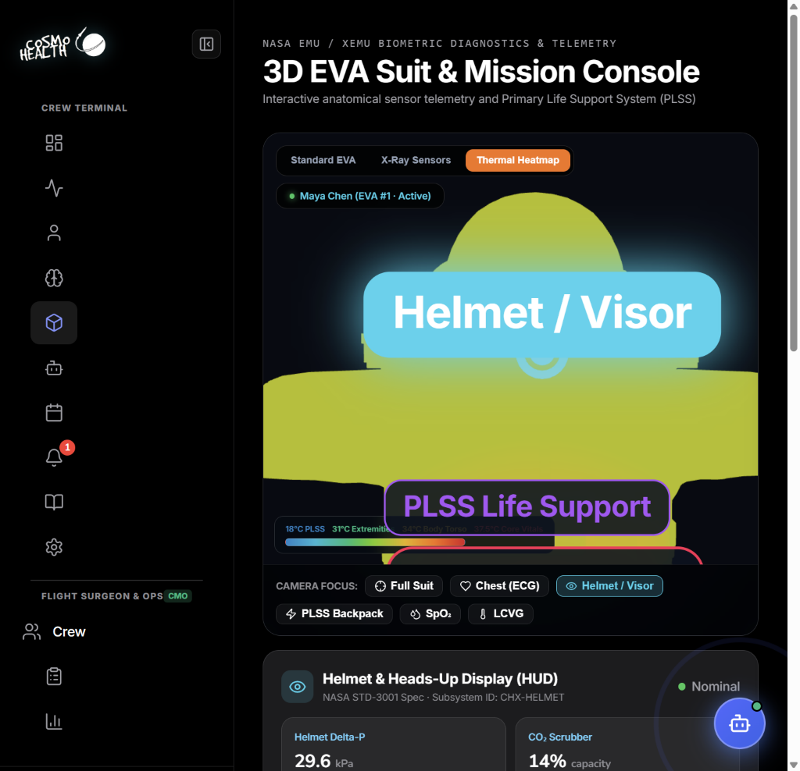
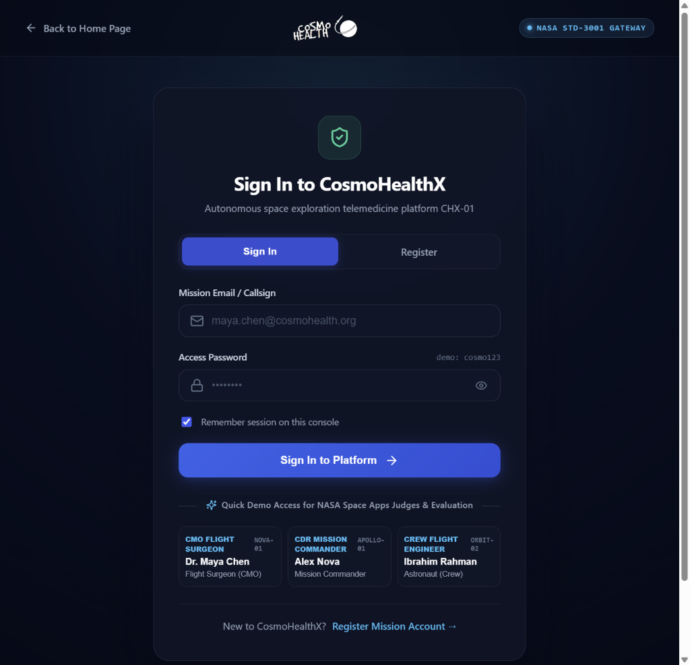
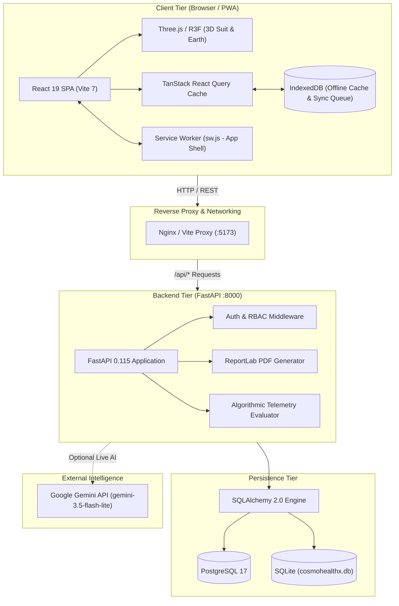

# CosmoHealthX

**Autonomous Space Telemedicine & Biomedical Telemetry Intelligence**

Developed for the **NASA Space Apps Challenge** theme: *"Create Health Monitoring Software for Astronauts on Space Missions"*.

[](https://react.dev/)
[](https://www.typescriptlang.org/)
[](https://vite.dev/)
[](https://threejs.org/)
[](https://fastapi.tiangolo.com/)
[](https://www.python.org/)
[](https://www.postgresql.org/)
[](https://www.sqlite.org/)
[](https://web.dev/explore/progressive-web-apps)

---

## Table of Contents

- [Overview](#overview)
- [Key Features](#key-features)
- [Screenshots & Visual Tour](#screenshots--visual-tour)
- [Technology Stack](#technology-stack)
- [System Architecture](#system-architecture)
- [Installation & Local Setup](#installation--local-setup)
  - [Prerequisites](#prerequisites)
  - [Option A: Docker Compose (PostgreSQL)](#option-a-docker-compose-postgresql)
  - [Option B: Bare-Metal Setup (SQLite)](#option-b-bare-metal-setup-sqlite)
- [Environment Variables](#environment-variables)
- [API Reference](#api-reference)
- [Database & Seed Data](#database--seed-data)
- [Offline & PWA Capabilities](#offline--pwa-capabilities)
- [Testing & Quality Assurance](#testing--quality-assurance)
- [Security & Medical Disclaimers](#security--medical-disclaimers)
- [Roadmap](#roadmap)
- [Documentation Index](#documentation-index)
- [Acknowledgements](#acknowledgements)

---

## Overview

### The Challenge of Space Telemedicine
During long-duration spaceflight—such as missions aboard the International Space Station, lunar Artemis sorties, or future transits to Mars—astronauts operate in extreme microgravity and deep-space radiation environments. Physiological hazards include cephalad fluid shift, cardiovascular deconditioning, bone mineral density loss, muscle atrophy, and circadian disruption caused by 16 orbital sunrises per day.

Because deep-space missions incur one-way communication latencies between 5 to 22 minutes, real-time clinical intervention from ground-based Mission Control is not always feasible. Astronaut crews require autonomous biomedical monitoring platforms capable of synthesizing biometric streams, identifying anomalies, providing evidence-based countermeasure protocols, and tracking mental resilience independently.

### What CosmoHealthX Provides
**CosmoHealthX** is a prototype space telemedicine and clinical biometric monitoring platform designed in accordance with **NASA STD-3001** (Space Flight Human-System Standard) and **NASA Human Research Program (HRP)** guidelines. It features:
- A high-density mission telemetry dashboard with real-time biometric indicators.
- Longitudinal trend analytics across 12 distinct physiological markers.
- Behavioral health check-ins and guided neuro-respiratory pacing exercises.
- An onboard AI Flight Surgeon powered by Google Gemini with an offline evidence-based clinical fallback.
- Standard Operating Procedure (SOP) clinical checklists with digital execution logs.
- Automated on-the-fly PDF and JSON medical dossier generation.
- Interactive 3D visualization of the Extravehicular Mobility Unit (EMU) spacesuit and sensor placements.
- A fully responsive Progressive Web Application (PWA) supporting offline access and idempotent sync.

> **Demonstration Notice:** CosmoHealthX is an educational engineering prototype. It contains no real astronaut health data, uses synthetic telemetry for demonstration, and is not certified as a clinical medical device.

---

## Key Features

### 1. Mission Dashboard (`/dashboard`)
- **Mission Operational Status**: Displays Mission Elapsed Time (MET), orbital day count (Day 42 of 180), active flight mode, and automated anomaly badges.
- **Crew Telemetry Cards**: Real-time status cards displaying Heart Rate, Heart Rate Variability (HRV), Pulse Oximetry ($SpO_2$), Core Temperature, and Blood Pressure.
- **Crew Quick-Switching**: Instant switching between active expedition crew members to evaluate individual physiological baselines.
- **EVA Suit Telemetry**: Integrated 3D spacesuit preview displaying Primary Life Support System (PLSS) battery reserve, $O_2$ cylinder pressure, and sublimator coolant levels.

### 2. Longitudinal Health Monitoring (`/monitoring`)
- **12 Verified Biometric Markers**:
  - Cardiovascular: Heart Rate (`bpm`), HRV RMSSD (`ms`), Blood Oxygen Saturation $SpO_2$ (`%`), Respiratory Rate (`/min`).
  - Neuro-Circadian: Sleep Duration (`hours`), Sleep Quality index (`1–5`), Core Temperature (`°C`).
  - Environmental & Physical: Ionizing Radiation Exposure (`mSv`), Active Physical Countermeasures (`min`), Daily Hydration Intake (`L`).
  - Psychological: Cognitive Focus score (`1–5`), Perceived Stress score (`1–5`).
- **Interactive Multi-Period Trends**: Dynamic Recharts graphs supporting 24-hour, 7-day, 30-day, and 90-day historical time windows with NASA STD-3001 safety envelope reference bands.

### 3. Behavioral Health & Performance (`/mental`)
- **Daily Psychological Check-in**: Standardized five-dimensional self-reporting (Mood, Cognitive Focus, Stress Level, Isolation Feeling, and Sleep Quality) with qualitative notes.
- **Resilience Pacing Tool**: Integrated interactive breathing timer featuring guided 4-7-8 and box-breathing cadences to modulate vagal autonomic tone during acute mission stress.
- **Longitudinal Wellbeing History**: Historical logs correlating self-reported psychological states with physiological stress indicators.

### 4. AI Clinical Assistant (`/ai` & Floating Chat)
- **Onboard Flight Surgeon Persona**: Context-aware clinical telemetry interpreter configured with NASA STD-3001 Vol 1 and ESA spaceflight medical standards.
- **Live Gemini Integration**: Translates complex biometric anomaly patterns into structured clinical countermeasure advisories via Google Gemini (`gemini-3.5-flash-lite` or `gemini-2.0-flash`).
- **Graceful Deterministic Fallback**: If the Gemini API key is not configured or the network is disconnected, the system automatically uses an onboard algorithmic clinical decision engine to evaluate telemetry safety envelopes without failing.

### 5. Medical Operations & Protocols (`/protocols`)
- **Evidence-Based SOP Checklists**: Pre-configured emergency and routine space medicine workflows linked directly to official NASA HRP literature:
  - *SOP-MED-01*: Management of Acute Tachycardia and Arrhythmia during EVA.
  - *SOP-ENV-02*: Solar Particle Event (SPE Class M/X) Radiation Shelter Ingress.
  - *SOP-BAR-03*: Decompression Sickness (DCS) & Hyperbaric Treatment Protocol.
  - *SOP-CIR-04*: Circadian Lighting Shift & Sleep-Wake Protocol.
- **Digital Step Verification**: Step-by-step interactive verification checklists.
- **Execution Audit Logging**: Records execution timestamps, responsible flight officer (`Dr. Maya Chen (CMO)`), and clinical verification notes.

### 6. Reports & PDF Medical Dossier (`/analytics`)
- **Clinical Summary Aggregation**: Computes sample counts, mean, min, max, and period-over-period percentage delta across all physiological parameters.
- **Instant PDF Dossier Generation**: On-the-fly binary generation of multi-page medical passports and clinical review dossiers using ReportLab (`GET /api/reports/{id}/pdf`).
- **Structured JSON Export**: Complete machine-readable telemetry export for mission ground control integration (`GET /api/reports/{id}`).

### 7. 3D Spacesuit & Anomaly Visualizer (`/3d` & `/3d-viewer`)
- **High-Fidelity EMU Model**: 16.7 MB optimized GLB asset depicting the Extravehicular Mobility Unit (EMU / xEMU) with WebP textures.
- **3 Diagnostic Render Modes**:
  - *Standard EVA*: Photorealistic spacesuit surface rendering.
  - *X-Ray Sensors*: Translucent visualization revealing anatomical sensor placement and aligned skeletal framework.
  - *Thermal Heatmap*: Subsystem thermal load distribution across suit layers.
- **Camera Focus Presets**: Quick-focus triggers for Full Suit, Chest ECG, Helmet / Visor, PLSS Backpack, $SpO_2$ Wrist Sensor, and LCVG Liquid Cooling Garment loop.
- **3D Earth Globe**: Interactive WebGL globe on the landing portal (`/`) utilizing high-resolution day, night, cloud, and specular maps.

### 8. Progressive Web App (PWA) & Offline Capabilities
- **Installable Desktop/Mobile App**: Certified Web App Manifest (`manifest.webmanifest`) supporting standalone windowed execution across macOS, Windows, iOS, and Android.
- **Service Worker Caching**: Versioned cache-first strategy for static application assets (HTML, CSS, JS, icons, models) enabling offline app shell boots.
- **IndexedDB Client Snapshot**: Telemetry reads are mirrored locally in IndexedDB (`cosmohealthx-demo-v1`) to allow offline dossier inspection.
- **Idempotent Mutation Queue**: Mental health check-ins submitted while disconnected are safely queued in IndexedDB and automatically synchronized with `Idempotency-Key` headers upon reconnection.

---

## Screenshots & Visual Tour

Screenshots captured from the running CosmoHealthX application:

| Alerts & Telemetry Anomaly Center | 3D EVA Spacesuit Mission Console |
|:---:|:---:|
|  |  |
| *Real-time anomaly triage, severity filtering, and glass telemetry cards.* | *Interactive 3D EMU model with subsystem status and sensor telemetry.* |

| Mission Landing Portal & 3D Earth | Responsive Navigation & Telemetry |
|:---:|:---:|
|  | *(Collapsible desktop sidebar & mobile bar layout)* |
| *Interactive 3D Earth globe, live biometric ticker, and mission orientation.* | *Optimized for 110% desktop displays, tablets, and mobile handsets.* |

> Additional view captures (Dashboard, Monitoring, Behavioral Health, and Protocols) can be saved into `docs/screenshots/` following this structure.

---

## Technology Stack

### Frontend Architecture
- **Framework**: React 19 (`react` 19.0.0, `react-dom` 19.0.0)
- **Tooling & Bundler**: Vite 7 (`vite` 7.3.8, `@vitejs/plugin-react` 5.0.0)
- **Language**: TypeScript 5.9
- **Client Routing**: React Router 7 (`react-router-dom` 7.0.0)
- **Server State & Caching**: TanStack React Query 5 (`@tanstack/react-query` 5.0.0)
- **3D Graphics & WebGL**: Three.js (`three` 0.180.0), React Three Fiber (`@react-three/fiber` 9.0.0), React Three Drei (`@react-three/drei` 10.0.0)
- **Data Visualization**: Recharts 3 (`recharts` 3.0.0)
- **Animation & Transitions**: Framer Motion 12 (`framer-motion` 12.0.0)
- **Iconography**: Lucide React (`lucide-react` 0.500.0)
- **PWA / QR Utilities**: Native Service Worker API, IndexedDB API, `qrcode` 1.5.4

### Backend Architecture
- **Web Framework**: FastAPI 0.115+ (Python 3.12+)
- **ASGI Server**: Uvicorn 0.34+ with standard async event loops
- **ORM & Data Layer**: SQLAlchemy 2.0+ (declarative models, relationship mapping)
- **Schema Validation**: Pydantic 2.10+ (strict typing and serialization)
- **Database Drivers**: `psycopg` 3.2+ (PostgreSQL), native `sqlite3` (SQLite)
- **HTTP Client**: HTTPX 0.28+ (asynchronous requests for external AI inference)
- **Document Rendering**: ReportLab 4.2+ (dynamic vector PDF dossier generation)
- **Testing**: Pytest 8.0+

### Database Systems
- **Production / Container**: PostgreSQL 17 (`postgres:17-alpine`)
- **Development / Local Default**: SQLite (`cosmohealthx.db` with thread-safe connection pooling)
- **Client Offline Storage**: Browser IndexedDB (`cosmohealthx-demo-v1`)

---

## System Architecture



---

## Installation & Local Setup

### Prerequisites
- **Node.js**: `v20.x` or `v22.x` (LTS recommended, minimum `v18.x`)
- **npm**: `v10.x` or higher
- **Python**: `3.12.x` (minimum `3.10.x`)
- **Git**: Installed and configured
- *(Optional)* **Docker & Docker Compose**: For containerized deployment

---

### Option A: Docker Compose (PostgreSQL)

Docker Compose builds the frontend, sets up the FastAPI backend, and provisions a PostgreSQL 17 database automatically.

1. **Clone the repository:**
   ```bash
   git clone https://github.com/dilovar6666/ns.git cosmohealthx
   cd cosmohealthx
   ```

2. **Configure environment:**
   ```bash
   cp .env.example .env
   # Edit .env to add your GEMINI_API_KEY if AI features are desired
   ```

3. **Build and start services:**
   ```bash
   docker compose up --build
   ```

4. **Access the application:**
   - **Frontend Application**: [http://127.0.0.1:5173](http://127.0.0.1:5173)
   - **Interactive API Documentation (Swagger)**: [http://127.0.0.1:8000/docs](http://127.0.0.1:8000/docs)
   - **Alternative ReDoc Docs**: [http://127.0.0.1:8000/redoc](http://127.0.0.1:8000/redoc)

---

### Option B: Bare-Metal Setup (SQLite)

For rapid evaluation without Docker, run the backend and frontend directly. The backend automatically initializes and seeds a local SQLite database (`cosmohealthx.db`).

#### 1. Backend Setup
From the repository root:

```bash
# Create Python virtual environment
python -m venv .venv

# Activate virtual environment
# Windows (PowerShell):
.venv\Scripts\Activate.ps1
# Windows (Command Prompt):
.venv\Scripts\activate.bat
# Linux / macOS:
source .venv/bin/activate

# Install dependencies
pip install -r backend/requirements.txt

# Start backend with auto-reload (from repository root)
python -m uvicorn app.main:app --app-dir backend --host 127.0.0.1 --port 8000 --reload
```

*Note: Database tables and synthetic demo records are created automatically on application startup via `Base.metadata.create_all(engine)`.*

#### 2. Frontend Setup
In a separate terminal:

```bash
cd frontend

# Install npm dependencies
npm install

# Start Vite development server
npm run dev
```

The frontend will start at [http://127.0.0.1:5173](http://127.0.0.1:5173). Requests to `/api/*` are automatically proxied to the backend on `http://127.0.0.1:8000`.

---

## Environment Variables

Configure environment variables in the root `.env` file or directly in the system environment:

| Variable | Description | Default Value | Required |
|:---|:---|:---|:---:|
| `DATABASE_URL` | SQLAlchemy connection URI. Supports SQLite and PostgreSQL. | `sqlite:///./cosmohealthx.db` | No |
| `GEMINI_API_KEY` | Google Gemini API key for live flight surgeon intelligence. If omitted, local evidence-based clinical fallback operates. | *(empty)* | No |
| `GEMINI_MODEL` | Gemini model identifier used for clinical inference. | `gemini-3.5-flash-lite` | No |
| `FRONTEND_ORIGIN` | Allowed CORS origins for the FastAPI backend (comma-separated). | `http://localhost:5173` | No |
| `POSTGRES_PASSWORD` | PostgreSQL password used by Docker Compose. | `local-demo-only` | Only for Docker |
| `VITE_API_PROXY_TARGET` | Backend target URL for the Vite development proxy. | `http://127.0.0.1:8000` | No |

---

## API Reference

The FastAPI backend exposes REST endpoints under the `/api` prefix. Key routes include:

### System & Authentication
- `GET /api/status` — Health check, database status, and synthetic data provenance tag.
- `POST /api/auth/register` — Register demo user with credentials and role assignment.
- `POST /api/auth/login` — Authenticate and obtain active session token.
- `GET /api/auth/me` — Inspect current session user and active permissions.

### Crew & Astronaut Management
- `GET /api/astronauts` — List all crew members with flight statuses and assigned missions.
- `GET /api/astronauts/{id}` — Retrieve detailed medical dossier for a specific astronaut.
- `POST /api/astronauts` — Provision a new crew member *(Requires Medical Officer or Admin role)*.
- `PUT /api/astronauts/{id}` — Update crew dossier records *(Requires Medical Officer or Admin role)*.
- `POST /api/astronauts/{id}/avatar` — Update custom crew avatar.

### Telemetry & Biometrics
- `GET /api/astronauts/{id}/metrics?period={24h|7d|30d|90d}` — Retrieve historical time-series for all 12 physiological indicators.
- `POST /api/astronauts/{id}/metrics` — Ingest biometric observation packet.

### Behavioral Health & Operations
- `GET /api/astronauts/{id}/checkins` — Retrieve mental health check-in history.
- `POST /api/astronauts/{id}/checkins` — Record new mental check-in *(Supports `Idempotency-Key` header)*.
- `GET /api/notifications` — Retrieve active anomaly notifications with severity levels.
- `PATCH /api/notifications/{id}/read` — Acknowledge and mark notification as read.
- `GET /api/timeline` — Retrieve mission operational events and milestone logs.

### Clinical Protocols (SOPs)
- `GET /api/protocols` — List all space medicine standard operating procedures and source URLs.
- `POST /api/protocols` — Register new clinical protocol *(Requires Admin role)*.
- `GET /api/protocols/{id}/executions` — Retrieve historical completion logs for a protocol.
- `POST /api/protocols/{id}/executions` — Record verified execution checklist and clinical notes.

### Reports & Intelligence
- `GET /api/reports/{id}?days={7|30|90}` — Compute statistical health review (mean, min, max, delta).
- `GET /api/reports/{id}/pdf?days={7|30|90}` — Generate and stream binary A4 medical dossier PDF.
- `POST /api/ai/analyze` — Request clinical telemetry interpretation via Gemini AI or local fallback.
- `GET /api/evidence` — Reference catalogue of NASA STD-3001 and GeneLab scientific papers.

---

## Database & Seed Data

### Provenance of Data
Every observation, metric, and event in CosmoHealthX is **synthetically generated** for demonstration purposes. The seed script populates:
- **Expedition CHX-01**: A simulated 180-day crewed orbital mission currently on Day 42.
- **4 Astronaut Profiles**:
  1. `Maya Chen` (`NOVA-01`) — Mission Commander
  2. `Ibrahim Rahman` (`ORBIT-02`) — Flight Engineer
  3. `Elena Petrova` (`PULSE-03`) — Research Specialist
  4. `Luis Ortega` (`VECTOR-04`) — Medical Officer
- **Historical Telemetry**: 14 days of realistic physiological variance per astronaut for all 12 biometric parameters, explicitly labeled with `source: "simulated demo"`.
- **Mission Milestones**: Timeline events documenting solar particle events (SPE), EVA spacewalks, GeneLab sampling, and sleep reviews.

---

## Offline & PWA Capabilities

CosmoHealthX is engineered to simulate space mission conditions where connectivity to Earth or central servers is intermittently unavailable:

| Feature | Offline Behavior | Mechanism |
|:---|:---|:---|
| **App Shell & UI** | Fully operational | Service Worker cache-first storage (`sw.js`) |
| **Dossier & Telemetry Reading** | Displays last loaded snapshot | IndexedDB cached read store (`cosmohealthx-demo-v1`) |
| **3D EMU Suit & Earth Globes** | Fully interactive | Pre-cached WebGL assets and textures |
| **Mental Health Check-in** | Saves offline, syncs automatically on reconnect | IndexedDB queue with `Idempotency-Key` header replay |
| **Breathing Pacing Exercise** | Fully operational | Local client-side requestAnimationFrame timer |
| **PDF Report Generation** | Requires active server | Generated dynamically on server via ReportLab |
| **Live Gemini AI Queries** | Switched to onboard fallback | Algorithmic telemetry rule engine handles requests locally |

---

## Testing & Quality Assurance

All test suites and build scripts are verified against the current repository state:

### 1. Backend Automated Tests
Execute the Pytest test suite from the `backend/` directory:

```bash
cd backend
python -m pytest tests -q
```

**Verified Coverage:**
- System status and synthetic data provenance tagging.
- Crew listing and RBAC permission checks.
- Metric ingestion and time-series queries.
- Offline check-in idempotency replay deduplication.
- Statistical calculation engine and prior-period delta analysis.
- Protocol step execution and audit log persistence.
- ReportLab binary PDF generation (`%PDF` header verification).
- Gemini AI fallback response when external API key is absent.

### 2. Frontend Production Build
Compile TypeScript and bundle production assets from the repository root:

```bash
npm run build --prefix frontend
```

**Verified Execution:**
- TypeScript strict type checking (`tsc -b`).
- Vite minification and code splitting.
- Asset bundle verification (`dist/index.html`, `dist/assets/*.css`, `dist/assets/*.js`).

---

## Security & Medical Disclaimers

> ### IMPORTANT MEDICAL & CLINICAL NOTICE
> **CosmoHealthX is an educational engineering demonstration and concept prototype created for the NASA Space Apps Challenge.**
> - It is **not** a certified medical device and has not been evaluated by the FDA, CE-MDR, or any medical regulatory authority.
> - It does **not** provide clinical diagnosis, triage, treatment recommendations, or real-time life support telemetry.
> - All biometric observations, physiological anomalies, and medical events are **synthetic simulations**.

> ### SECURITY & DEMONSTRATION LIMITATIONS
> - The role selection controls (Flight Surgeon, Commander, Astronaut) are designed for demonstration evaluation and do not represent a hardened enterprise authentication boundary.
> - Do not deploy this demonstration application to untrusted public networks with sensitive or real patient health information.
> - Production deployment requires an enterprise identity provider (OIDC/SAML), role-based claims verification, end-to-end TLS encryption, audit logging, and formal compliance review (HIPAA / GDPR).

---

## Roadmap

Planned future capabilities for future mission architectures:
- [ ] **Live Biometric Telemetry Streaming**: WebSockets / Server-Sent Events (SSE) for sub-second sensor feeds.
- [ ] **Bidirectional CRDT Data Sync**: Conflict-free Replicated Data Types for multi-node offline station mesh synchronization.
- [ ] **Hardware Sensor Integration**: Web Bluetooth (BLE) pairing for commercial heart rate straps and pulse oximeters.
- [ ] **Volumetric Anatomical CT/MRI Scan Viewer**: Expanding beyond EMU suit visualization to 3D internal anatomical scans.
- [ ] **Voice-Activated Hands-Free Assistant**: Speech-to-text clinical query engine for hands-free operations during spacewalks.

---

## Documentation Index

To ensure zero broken links and maintain full offline readability, the complete technical documentation for CosmoHealthX is consolidated directly within this `README.md`:

- [System Architecture & Data Flow](#system-architecture)
- [Complete Installation & Setup Guide](#installation--local-setup)
- [Environment Variables Specification](#environment-variables)
- [REST API Endpoint Directory](#api-reference)
- [Database Schema & Seed Provenance](#database--seed-data)
- [Offline Architecture & PWA Guide](#offline--pwa-capabilities)
- [Verification & Automated Test Suite](#testing--quality-assurance)

For external scientific references, consult the official NASA literature:
- [NASA STD-3001: Space Flight Human-System Standard](https://www.nasa.gov/hrp/)
- [NASA Human Research Program (HRP) Evidence Book](https://humanresearchroadmap.nasa.gov/)
- [NASA GeneLab Omics Architecture](https://genelab.nasa.gov/)

---

## Acknowledgements

- **NASA Space Apps Challenge 2026**: Global hackathon organizing team and challenge mentors for the inspirative theme.
- **NASA Human Research Program**: For publicly available aerospace medicine research and clinical spaceflight standards.
- **AstroMind Project**: UI design layout inspiration for high-density mission console patterns (four stored-vital cards and telemetry views). *Note: CosmoHealthX was written from scratch and incorporates no AstroMind code or assets.*
- **Open-Source Community**: FastAPI, React, Three.js, Lucide, ReportLab, and Vite contributors.

---

*Mission Operational Console · Expedition CHX-01 · Built with Precision for Deep-Space Exploration*
